<div align="center">
  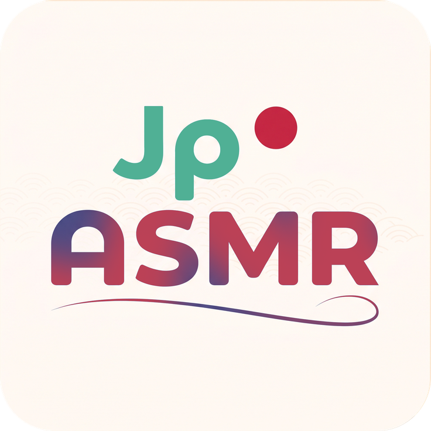
  <h1>JapaneseASMR Downloader</h1>
  <p><b>Aplikasi Android native berperforma tinggi untuk menjelajah, streaming, mengunduh, mengelola, dan memutar karya audio Japanese ASMR.</b></p>

  <p>
    <a href="README.md">English</a> |
    <a href="README.id.md">Bahasa Indonesia</a> |
    <a href="README.zh.md">简体中文</a>
  </p>

  <p>
    <a href="https://github.com/SayMaven/japaneseasmr-android/releases/latest"></a>
    <a href="https://github.com/SayMaven/japaneseasmr-android/blob/main/LICENSE"></a>
    
    
    
  </p>

  <p>
    <a href="#fitur-utama">Fitur Utama</a> •
    <a href="#tangkapan-layar">Tangkapan Layar</a> •
    <a href="#arsitektur-aplikasi">Arsitektur</a> •
    <a href="#unduh-aplikasi">Unduh</a> •
    <a href="#kompilasi-dari-kode-sumber">Kompilasi</a> •
    <a href="#lisensi">Lisensi</a>
  </p>
</div>

---

> [!NOTE]
> Aplikasi ini awalnya dibuat untuk pemakaian pribadi dan saat ini mungkin masih ada beberapa bug. Terima kasih buat yang sudah download! Saya akan perbaiki pelan-pelan kalau ada waktu luang. Feel free to open an issue or PR!

## Gambaran Umum

JapaneseASMR Downloader adalah aplikasi Android sumber terbuka (open-source) lengkap untuk menjelajah, streaming online, mengunduh, mengarsipkan, dan mendengarkan drama suara ASMR Jepang (karya RJ / VJ / BJ). Dibangun dengan Jetpack Compose, Koin DI, Kotlin Coroutines, Room Database, AndroidX Media3 (ExoPlayer), dan mesin audio native C++ Oboe / USB DAC, aplikasi ini menghadirkan streaming yang mulus serta pemutaran lokal berkualitas bit-perfect di perangkat mobile.

---

## Tangkapan Layar

<div align="center">
  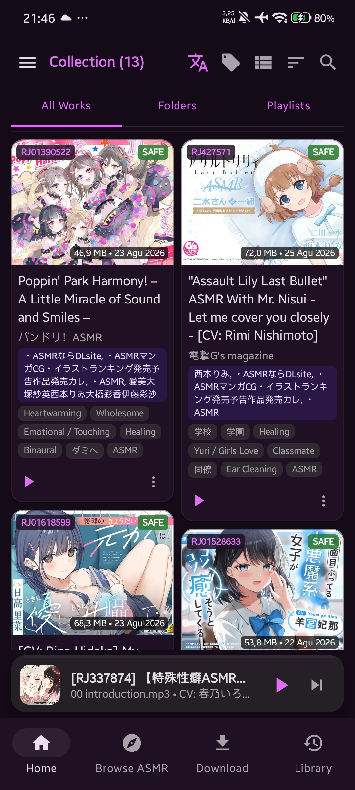
  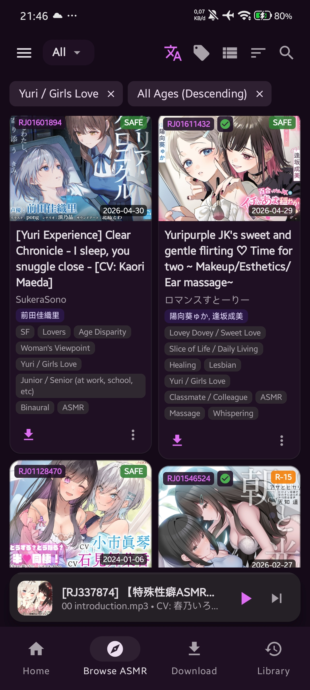
  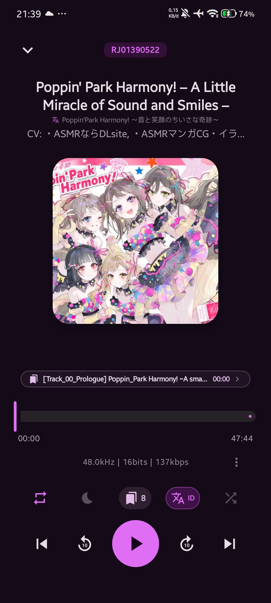
  <br />
  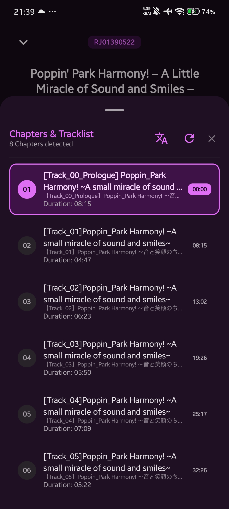
  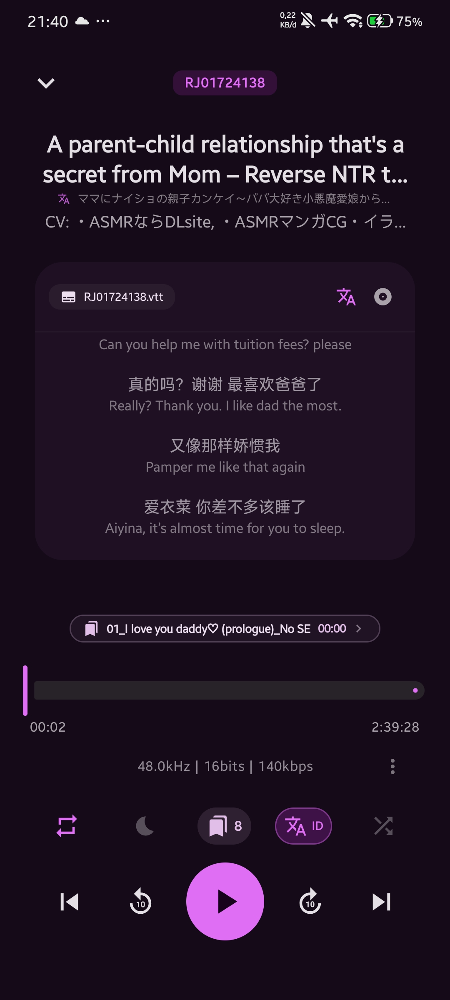
  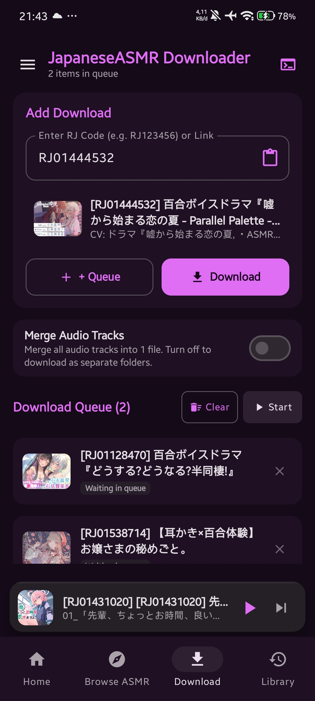
  <br />
  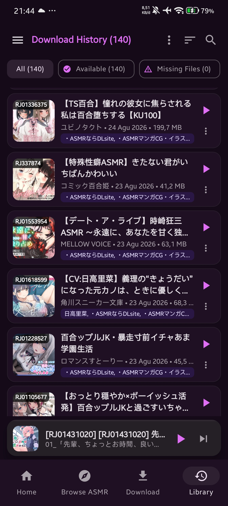
  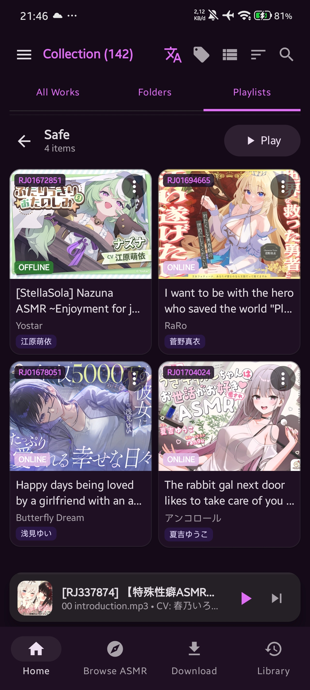
  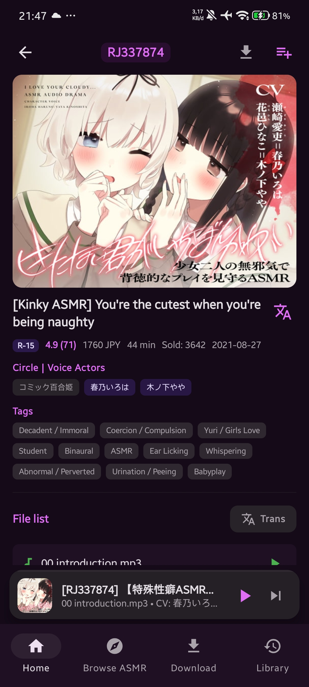
  <br />
  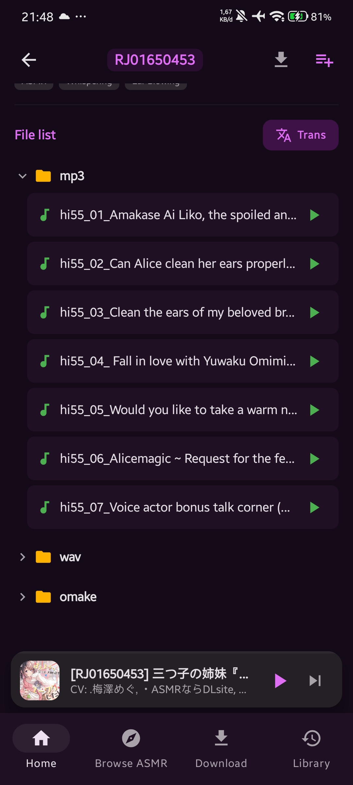
  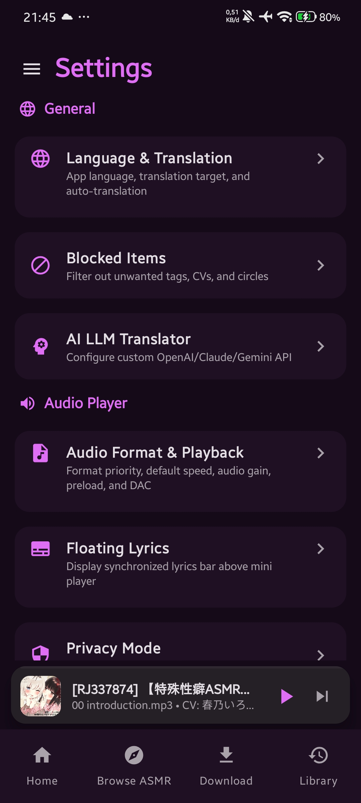
  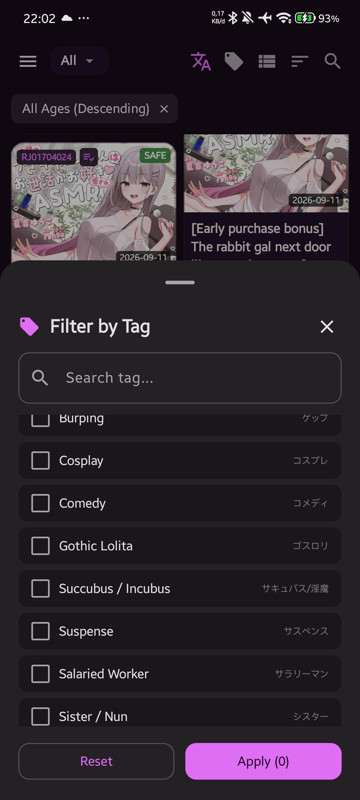
</div>

---

## Fitur Utama

### Jelajah ASMR & Streaming Online Langsung
* **Jelajah Bergaya Pinterest & Detail Karya:** Jelajahi karya ASMR dalam tampilan grid atau list dengan pengurutan ala KikoFlu, filter multi-tag, mode aman Semua Usia (*All-Ages*), serta pohon berkas interaktif di Detail Karya.
* **Streaming Audio Online Langsung:** Putar karya langsung secara online tanpa perlu mengunduh lebih dulu, termasuk fallback otomatis ke streaming online di Playlist jika file lokal telah dihapus.
* **Pemilihan Bab & Trek Cerdas:** Otomatis memprioritaskan folder karya utama (`本編` / `main`) di atas folder promo atau recap (`販促`, `回想`) agar daftar bab dan durasi selalu akurat.

### Subtitle Tersinkronisasi, Lirik Mengambang & Terjemahan Multi-Provider
* **Dukungan Subtitle Lengkap:** Mendukung `.vtt`, `.lrc`, dan `.srt` dengan pengisian otomatis, panel lirik sinkron di Player, serta **Bar Lirik Mengambang** (*Floating Lyrics*, aktif default dalam mode terjemahan).
* **Terjemahan Multi-Provider & LLM:** Mendukung Google Translate (dengan antrean berurutan serta *failover* batch `clients5` & `MyMemory` saat `HTTP 429`), Microsoft Edge, Youdao, MyMemory, dan **provider LLM kustom** (Claude, Gemini, OpenAI-compatible) lengkap dengan glosarium ASMR Jepang & Mandarin.
* **Kunci API Terenkripsi & Cache Dua Tingkat:** API key LLM disimpan terenkripsi menggunakan Android Keystore AES-256-GCM (`SecurePreferences`), dengan cache terjemahan persisten di memori (`ConcurrentHashMap`) dan Room SQLite (`translation_cache`).

### Playlist Kustom, Folder Explorer & Koleksi Lokal
* **Playlist Kustom (Room v6):** Kelola karya offline maupun online dalam satu playlist dengan navigasi **antrean campuran** (`Next`/`Previous`, `Shuffle`, `Repeat`, dan *auto-advance*) di dalam playlist aktif.
* **Impor Folder Lokal & Kartu SD:** Pindai folder lokal maupun Kartu SD/penyimpanan eksternal melalui akses POSIX (`MANAGE_EXTERNAL_STORAGE`) atau SAF (`DocumentFile`) sebagai album multi-trek virtual, lengkap dengan thumbnail folder ala Explorer, penautan kode RJ/VJ/BJ, dan kustomisasi cover art.
* **Kustomisasi Kartu & Tombol Player:** Pilih badge yang tampil di kartu karya (Rating, Harga, Penjualan, Tanggal Rilis, Circle, ikon Subtitle `CC`, Rating Usia), cari cepat di header Koleksi Lokal, dan atur urutan tombol Player.

### Pemutar Audio Native, Penguatan Gain (dB) & Mode Privasi
* **Integrasi Android MediaSession & Sleep Timer:** Pemutaran latar belakang dengan kontrol notifikasi, cover layar kunci, Floating Mini Player, dan Sleep Timer yang ikut jeda saat audio di-pause.
* **Penguatan Audio (dB) & USB DAC Exclusive Mode:** Tingkatkan volume bisikan ASMR (dB) baik lewat ExoPlayer maupun mesin native C++ Oboe / USB DAC (UAC1/UAC2) lengkap dengan kontrol volume hardware DAC.
* **Mode Privasi:** Blur sampul di dalam aplikasi maupun notifikasi sistem, serta samarkan judul karya dengan teks pengganti kustom.

### Pengunduh Berkecepatan Tinggi, Manajemen Cache & Backup
* **Mode Gabung Trek atau Multi-Folder:** Pilih apakah trek digabung menjadi 1 berkas (`FileChannel.transferTo` MP3 / remux M4A) atau diunduh sesuai struktur folder asli, lengkap dengan tagging ID3v2/MP4, ekspor `.cue`, dan 4–32 koneksi paralel.
* **Manajemen Cache & Auto-Clean:** Atur batas cache `200 MB – 10 GB` (default `1 GB`), opsi toggle *Auto-Clean* (default mati agar riwayat tetap aman), serta pembersihan cepat cache terjemahan.
* **Backup & Restore JSON + Refresh Semua Metadata:** Ekspor/impor Playlist dan Riwayat sebagai JSON (ditambah cadangan otomatis), serta tombol **Refresh Semua Metadata** di Pengaturan Unduhan untuk memperbarui rating usia dan metadata seluruh karya lokal secara massal.

### Sistem Warna OKLCH & UI Material 3 Adaptif
* **Mesin Palet Perseptual OKLCH:** 12 palet Terang/Gelap pilihan bersama Material You Dynamic Color dengan kontras WCAG AA, `NavigationRail` adaptif untuk tablet/layar lebar, dan 4 bahasa UI (Indonesia, Inggris, Jepang, Mandarin).
* **Auto-Updater Dalam Aplikasi:** Pembaruan langsung dari GitHub Releases dengan pencocokan kanal Debug/Release (`*-debug.apk` / `*-release.apk`) via `FileProvider`.

---

## Arsitektur Aplikasi

| Lapisan | Komponen | Deskripsi |
| :--- | :--- | :--- |
| **UI Layer** | Jetpack Compose + Material 3 | Antarmuka deklaratif, tema perseptual OKLCH, `NavigationRail` adaptif |
| **DI & Navigasi** | Koin DI + Navigation Compose | ViewModel/delegate modular, `@Serializable` `AppRoute` |
| **State Management** | Kotlin Coroutines + StateFlow | Aliran data reaktif searah (UDF) |
| **Media & Audio Native** | AndroidX Media3 + C++ Oboe | Streaming/pemutar ExoPlayer, MediaSession, mesin eksklusif USB DAC |
| **Database Lokal** | Room Database v6 (SQLite) | Riwayat, Playlist kustom, `translation_cache` persisten |
| **Pemrosesan Audio** | FastRemuxEngine + Jaudiotagger | Penggabungan MP3 zero-copy, remux M4A, ekspor CUE, tagging ID3v2/MP4 |
| **Mesin Terjemahan** | TranslationService + LLM Client | Google (`gtx` + `clients5`), MyMemory, Edge, Youdao, LLM terenkripsi |
| **Jaringan & Gambar** | OkHttp 4 + Coil Compose | HTTP/2 connection pooling, unduhan multithread, cache sampul asinkron |
| **Kualitas & Keamanan** | Detekt + MockWebServer + Keystore | Analisis statis, unit/migration test, enkripsi AES-256-GCM, R8 shrinking |

---

## Unduh Aplikasi

Berkas APK rilis universal yang ditandatangani secara resmi tersedia di halaman GitHub Releases:

[**Unduh Rilis Terbaru (GitHub Releases)**](https://github.com/SayMaven/japaneseasmr-android/releases/latest)

---

## Kompilasi dari Kode Sumber

### Prasyarat
* JDK 21
* Android SDK (compileSdk 36 / Build Tools 35+)
* Gradle 8.10.2 (sudah termasuk melalui Gradle Wrapper)

### Kloning dan Kompilasi
```bash
# Kloning repositori
git clone https://github.com/SayMaven/japaneseasmr-android.git
cd japaneseasmr-android

# Kompilasi Debug APK
./gradlew assembleDebug
```

Berkas APK hasil kompilasi akan tersimpan di:
```text
app/build/outputs/apk/debug/JapaneseASMR-v2.0.0-debug.apk
```

---

## Pernyataan Penyangkalan (Disclaimer)

Perangkat lunak ini dikembangkan secara ketat untuk tujuan pribadi, edukasi, dan pengarsipan cadangan. Pengembang tidak menyediakan, mendistribusikan, atau mempromosikan media berhak cipta. Pengguna bertanggung jawab penuh untuk memastikan kepatuhan terhadap undang-undang hak cipta dan ketentuan layanan yang berlaku di wilayah hukum masing-masing.

---

## Lisensi

Proyek ini dilisensikan di bawah [GNU General Public License v3.0 (GPL-3.0)](LICENSE).
