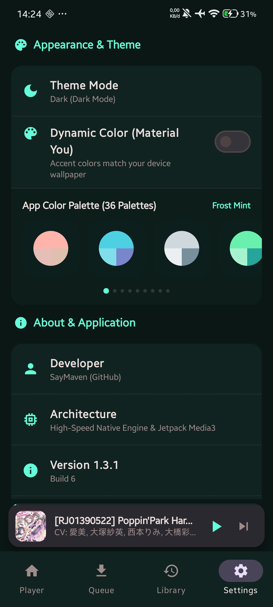
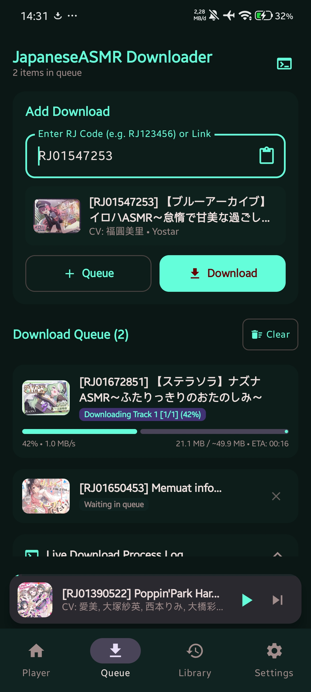
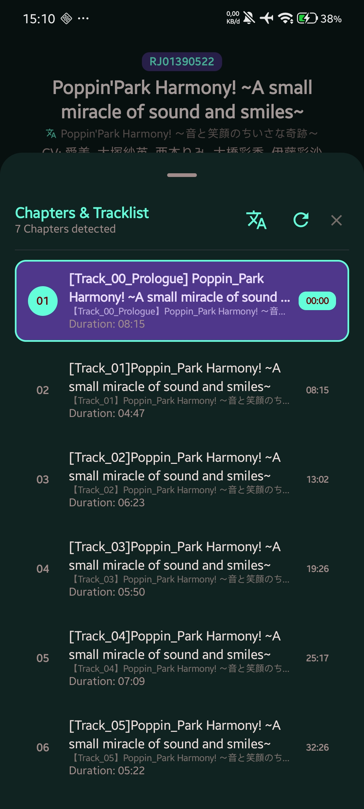

<div align="center">
  
  <h1>JapaneseASMR Downloader</h1>
  <p><b>Aplikasi Android native berperforma tinggi untuk mengunduh, mengelola, dan memutar karya audio Japanese ASMR.</b></p>

  <p>
    <a href="README.md">English</a> |
    <a href="README.id.md">Bahasa Indonesia</a> |
    <a href="README.zh.md">简体中文</a>
  </p>

  <p>
    <a href="https://github.com/SayMaven/japaneseasmr-android/releases/latest"></a>
    <a href="https://github.com/SayMaven/japaneseasmr-android/blob/main/LICENSE"></a>
    
    
    
  </p>

  <p>
    <a href="#apa-yang-baru-di-v131">Pembaruan</a> •
    <a href="#fitur-utama">Fitur Utama</a> •
    <a href="#tangkapan-layar">Tangkapan Layar</a> •
    <a href="#unduh-aplikasi">Unduh</a> •
    <a href="#kompilasi-dari-kode-sumber">Kompilasi</a> •
    <a href="#arsitektur-aplikasi">Arsitektur</a> •
    <a href="#lisensi">Lisensi</a>
  </p>
</div>

---

## Gambaran Umum

JapaneseASMR Downloader adalah aplikasi Android sumber terbuka (open-source) lengkap yang dirancang khusus untuk mengunduh, mengarsipkan, dan mendengarkan drama suara ASMR Jepang (Karya RJ). Dibangun menggunakan teknologi modern Android seperti Jetpack Compose, Kotlin Coroutines, Room Database, dan AndroidX Media3 (ExoPlayer), aplikasi ini menghadirkan performa pengunduhan berkecepatan tinggi, keamanan memori tanpa risiko OOM (Out of Memory), serta pemutaran audio latar belakang yang stabil dan hemat daya.

---

## Apa yang Baru di v1.3.1

* **Lokalisasi Antarmuka Multi-Bahasa Lengkap**: Dukungan penuh untuk 4 bahasa: **English (`en`)**, **Bahasa Indonesia (`in`)**, **日本語 / Jepang (`ja`)**, dan **简体中文 / Mandarin (`zh`)**.
* **Deteksi Bahasa Sistem Otomatis**: Menyesuaikan bahasa tampilan secara otomatis mengikuti pengaturan bahasa perangkat Android pengguna tanpa konfigurasi tambahan.
* **Pemilih Bahasa Mandiri di Pengaturan**: Menu pengaturan bahasa khusus yang memungkinkan penggantian bahasa aplikasi secara bebas tanpa mengubah bahasa sistem ponsel.
* **Kompatibilitas Android 13+ Per-App Language**: Mendaftarkan konfigurasi `locales_config.xml` untuk integrasi penuh dengan pemilih bahasa per-aplikasi bawaan Android 13+.

---

## Apa yang Baru di v1.3.0

* **Mesin Terjemahan ASMR Kontekstual & Naturalisasi Bahasa**:
  * Arsitektur terjemahan dua tingkat yang memprioritaskan Google Web Translate dengan failover otomatis ke MyMemory Translation API.
  * De-obfuskasi sensor fuseji DLsite (`〇`, `○`, `×`, `*`) secara otomatis sebelum proses penerjemahan.
  * Glosarium domain ASMR khusus dan naturalisasi kontekstual yang teruji secara empiris pada 55 karya DLsite nyata dalam 11 tahap pengujian (~150 kiasan/trope), mencakup skenario intim, istilah roleplay, efek suara (onomatope), dan dialog drama suara.
  * Tampilan teks terjemahan dan subtitle bahasa Jepang dwibahasa secara langsung di bawah judul karya pada layar Pemutar dan Antrean.
* **Cache Database Room SQLite Persisten (Skema Database v4)**:
  * Pipeline cache dua tingkat: cache memori thread-safe (`ConcurrentHashMap`, 0ms) didukung database lokal Room SQLite (`translation_cache`, <2ms).
  * Pengambilan batch kueri SQL `IN` berefisiensi tinggi (`getTranslationsBatch`) untuk mencegah overhead kueri dan mengeliminasi permintaan jaringan berulang saat aplikasi dibuka ulang.
  * Migrasi skema database otomatis (`MIGRATION_3_4`).
* **Pemetaan Bab Cerdas Hibrida (Smart Hybrid Chapter Mapping)**:
  * Klasifikasi naratif multi-tingkat dan pengurutan kronologis: Prolog, Cerita Utama, Epilog, Bonus/After, dan Free Talk/Komentar Pengisi Suara.
  * Normalisasi Unicode NFKC penuh untuk pengurutan bab dan penomoran berkas multi-bagian yang akurat.
* **Mesin Remux Audio Lossless Cepat**:
  * Penggabungan audio zero-copy tingkat kernel (`FileChannel.transferTo`) untuk format MP3 dan remux kontainer sekuensial untuk AAC/M4A.
  * Penggabungan berkas instan (<1 detik) tanpa transcoding yang membebani CPU, mempertahankan kualitas audio bitstream 100% asli dan fungsi scrubbing instan.
* **Deteksi Bab Terpadu & Pembuatan CUE Sheet**:
  * Pipeline ekstraksi bab otomatis dari tag embedded ID3v2 `CHAP`/`CTOC`, berkas pendamping `.cue`, serta data karya remote DLsite.
  * Pembuatan berkas sidecar CUE opsional yang dapat diaktifkan di Pengaturan untuk pemutar media pihak ketiga.
* **Universal Link & Code Resolver**:
  * Ekstraksi dan resolusi otomatis kode produk RJ, VJ, dan BJ langsung dari tautan mentah (DLsite, asmr.one, dan pengalihan tautan JapaneseASMR).
* **Optimalisasi Tampilan Halus 120 FPS**:
  * Eliminasi operasi disk I/O dan IPC saat penyusunan ulang daftar putar (drag-and-drop).
  * Kompilasi pola regex di awal, optimalisasi cache memori Coil, dan penanganan gestur scroll bersarang yang aman dari fling.
* **Pembaruan Antarmuka Layar Pemutar & Antrean**:
  * Bilah toolbar pemutar baru dengan tombol toggle terjemahan, indikator bahasa aktif, dan chip pil bab yang ringkas.
  * Penskalaan cover art adaptif (`heightIn(max = 260.dp)`) untuk tata letak seimbang di berbagai rasio layar perangkat.
  * Kartu pratinjau antrean bilingual dengan telemetri transfer waktu-nyata dan desain status kosong yang lebih bersih.

---

## Tangkapan Layar

<div align="center">
  
  
  
  <br />
  
  
  
  <br />
  
  
  
</div>

---

## Fitur Utama

### Mesin Terjemahan ASMR Kontekstual & Cache Dua Tingkat
* **Terjemahan Khusus Domain**: Menerjemahkan judul bahasa Jepang, daftar trek, dan bab ke dalam bahasa tujuan secara alami dengan adaptasi kosakata khusus DLsite.
* **De-Obfuskasi Sensor Fuseji**: Mengembalikan simbol sensor pada judul secara otomatis sebelum diterjemahkan untuk menjaga keutuhan makna kontekstual.
* **Arsitektur Terjemahan Dua Tingkat**: Mesin utama Google Web Translate dengan failover otomatis ke MyMemory Translation API.
* **Cache Persisten Dua Tingkat**: Cache memori `ConcurrentHashMap` (0ms) didukung database Room SQLite v4 (`translation_cache`, <2ms), menjaga ketersediaan terjemahan antar sesi aplikasi.
* **Pengambilan Kueri Batch SQL**: Pengambilan banyak data sekaligus dalam satu kueri (`getTranslationsBatch`) untuk daftar putar dan daftar trek guna meminimalkan penggunaan CPU.
* **Tampilan Dwibahasa**: Tampilan bilingual waktu-nyata pada layar pemutar native dan kartu antrean unduhan.

### Mesin Remux Audio Lossless Cepat & Deteksi Bab
* **Penggabungan Audio Zero-Copy**: Menggabungkan trek MP3 multi-bagian dalam waktu kurang dari 1 detik menggunakan `FileChannel.transferTo` tanpa encoding ulang audio atau penurunan kualitas.
* **Remux Kontainer M4A Sekuensial**: Mengemas aliran data AAC terfragmentasi ke dalam kontainer ISO M4A standar untuk mendukung scrubbing timeline instan.
* **Pemetaan Bab Cerdas Hibrida**: Mengelompokkan dan mengurutkan berkas audio secara otomatis ke dalam kategori Prolog, Cerita Utama, Epilog, Bonus, dan Free Talk.
* **Normalisasi Unicode NFKC**: Menghilangkan ketidakkonsistenan penomoran pada angka berlingkar, karakter full-width, maupun angka kanji.
* **Deteksi Bab Terpadu**: Mengekstrak penanda bab dari tag ID3v2 `CHAP`/`CTOC`, berkas pendamping `.cue`, maupun data remote DLsite secara terpadu.
* **Ekspor Berkas CUE Sheet**: Membuat berkas `.cue` sidecar otomatis bersamaan dengan audio untuk kompatibilitas penuh dengan perangkat audiophile dan pemutar desktop.
* **Universal Link & Code Resolver**: Mendukung input tautan langsung dari DLsite, asmr.one, dan JapaneseASMR dengan resolusi kode otomatis.

### Mesin Pengunduhan & Demuxing Berkecepatan Tinggi
* **Koneksi Simultan Multithread**: Pengunduh segmen multi-jalur yang mendukung 4 hingga 32 jalur simultan (default 16) untuk memaksimalkan bandwidth internet.
* **Antrean Dinamis Otomatis**: Antrean baru langsung terintegrasi ke dalam proses unduh aktif secara berkelanjutan tanpa perlu restart manual.
* **Streaming Disk Tanpa Beban RAM**: Demuxing langsung ke penyimpanan internal/eksternal untuk menangani berkas audio berukuran gigabyte tanpa risiko `OutOfMemoryError`.
* **Remuxing Kontainer Standar**: Pengemasan kontainer ISO M4A / AAC native yang menjamin fungsi scrubbing timeline instan (0 detik) di semua pemutar audio pihak ketiga.
* **Deduplikasi Berkas Otomatis**: Mendeteksi keberadaan berkas di penyimpanan dan secara otomatis melewati pengunduhan ulang yang tidak diperlukan.
* **Konsol Log Interaktif**: Pemantauan progres unduhan, kecepatan transfer waktu-nyata, dan estimasi waktu selesai (ETA) dengan tombol toggle (`>_` / `</>`).

### Pemutar Audio Native Terintegrasi
* **Integrasi Android MediaSession**: Layanan pemutar latar belakang foreground dengan kontrol notifikasi lengkap dan tampilan cover art di layar kunci.
* **Sleep Timer Otomatis**: Penghitung waktu mundur yang tersinkronisasi dengan status pemutaran audio.
* **Floating Mini Player**: Kontrol pemutar melayang yang responsif di berbagai tab navigasi untuk pemutaran cepat dan ekspansi satu sentuhan.
* **Mode Eksklusif Bit-Perfect USB DAC**: Pengambilalihan antarmuka USB Audio Class (UAC1 / UAC2) langsung dengan pemisahan driver kernel Android untuk audio murni prioritas tinggi.
* **Kontrol Volume Perangkat Keras DAC**: Pengaturan langsung chip mixer DAC melalui USB Control Transfers (`SET_CUR` / `GET_RANGE`), pencegatan tombol volume fisik HP, dan HUD volume melayang.
* **Drawer Daftar Bab Interaktif**: Lembar daftar bab interaktif dengan fitur lompat waktu (tap-to-seek) yang tersinkronisasi dengan timeline.
* **Drawer Daftar Putar 0ms**: Daftar putar koleksi reaktif dengan fitur pengurutan ulang (drag-and-drop) instan.
* **Dialog Kecepatan Putar Halus**: Pengaturan kecepatan fleksibel dari 0.25x hingga 2.0x dengan preset 2x3.
* **Tombol Lompat 10 Detik**: Mundur 10 detik dan Maju 10 detik untuk navigasi dialog audio dengan mudah.
* **Format Waktu Persisten**: Pilihan format waktu putar (durasi total vs sisa waktu `-mm:ss`) tersimpan secara permanen.
* **Validasi Berkas Fisik**: Otomatis menyembunyikan berkas yang terhapus dari penyimpanan fisik dan memperbarui daftar saat berkas dikembalikan.

### Manajemen Koleksi & Metadata
* **Koleksi Riwayat 120 FPS**: Bebas hambatan operasi I/O pada thread utama dengan model data UI yang dihitung di awal untuk scrolling halus 120 FPS.
* **Sinkronisasi Penyimpanan Otomatis (StorageSyncManager)**: Memindai folder penyimpanan saat aplikasi dibuka/dilanjutkan, menyinkronkan berkas baru, berpindah, atau terhapus dengan database Room.
* **Filter Pengurutan Cerdas**: Pengurutan instan berdasarkan Waktu (Terbaru / Terlama) dengan presisi milidetik dan Judul (A-Z / Z-A).
* **Format Tanggal Standar**: Format tampilan tanggal yang seragam (`dd MMM yyyy`) di seluruh aplikasi.
* **Penyematan Metadata Lengkap**: Menyematkan cover art resolusi tinggi, Pengisi Suara (CV), Lingkaran/Pembuat (Circle), Judul Karya, dan Genre langsung ke dalam tag berkas audio (ID3v2 / MP4 atom).
* **Pencarian Cepat Offline**: Cari karya berdasarkan Kode RJ, judul, nama CV, atau circle pembuat.

### Tampilan Modern Material Design 3
* **4 Tab Navigasi Mandiri**: Home (Pemutar Penuh), Unduhan (Antrean Unduh), Riwayat (Koleksi Berkas), dan Pengaturan.
* **Retensi Sesi Stabil**: Buka aplikasi awal selalu di tab Home, dan tetap berada di tab aktif saat aplikasi diminimize.
* **Mesin Warna Dinamis Material You / Monet**: Penyesuaian tema otomatis berdasarkan warna wallpaper Android 12+.
* **36 Palet Warna Pilihan**: Pilihan palet warna lengkap dengan pratinjau lingkaran 3 segmen dan carousel horizontal.
* **Fast Cache Startup 0ms**: Penyimpanan cache tema sinkron untuk menghilangkan kedipan warna saat peluncuran awal.
* **Perpindahan Tab Instan**: Arsitektur GPU RenderNode layer yang mempertahankan seluruh tab di memori tanpa jeda rendering.
* **Dukungan Mode Gelap & Terang**: Tema sistem, gelap, dan terang penuh dengan transisi halus.

---

## Arsitektur Aplikasi

JapaneseASMR Downloader mengimplementasikan prinsip Modern Android Architecture dengan pemisahan modul yang jelas dan alur data searah (unidirectional data flow):

| Lapisan | Komponen | Deskripsi |
| :--- | :--- | :--- |
| **UI Layer** | Jetpack Compose + Material 3 | Antarmuka deklaratif, Animasi, Tema kustom Monet |
| **State Management** | Kotlin Coroutines + StateFlow | Aliran data reaktif yang sadar siklus hidup (lifecycle-aware) |
| **Media Player** | AndroidX Media3 (ExoPlayer) | Pemutar audio native, MediaSession, Foreground Service |
| **Database Lokal** | Room Database v4 (SQLite) | Riwayat pustaka, cache terjemahan persisten (`translation_cache`), pemetaan bab |
| **Pemrosesan Audio** | FastRemuxEngine | Penggabungan MP3 zero-copy, remux kontainer M4A sekuensial, ekspor sidecar CUE |
| **Mesin Terjemahan** | TranslationService | API Google Web/MyMemory dua tingkat, naturalisasi domain ASMR, de-obfuskasi fuseji |
| **Preferensi** | AndroidX DataStore + SharedPreferences Fast Cache | Penyimpanan preferensi tipe-aman dengan cache sinkron 0ms |
| **Jaringan** | OkHttp 4 | HTTP/2 connection pooling, unduhan multi-jalur simultan |
| **Tagging Audio** | Jaudiotagger | Penulisan tag metadata ID3v2 (`CHAP`/`CTOC`) dan MP4 atom |
| **Pemuatan Gambar** | Coil Compose | Dekoding gambar asinkron, cache memori dan hardware bitmap |

---

## Unduh Aplikasi

Berkas APK rilis yang telah dikompilasi dan ditandatangani secara resmi tersedia di halaman GitHub Releases:

[**Unduh Rilis Terbaru (GitHub Releases)**](https://github.com/SayMaven/japaneseasmr-android/releases/latest)

---

## Kompilasi dari Kode Sumber

### Prasyarat
* JDK 17 atau lebih baru
* Android SDK dengan Build Tools 35.0.0+
* Gradle 8.7+ (sudah termasuk melalui Gradle Wrapper)

### Kloning dan Kompilasi
```bash
# Kloning repositori
git clone https://github.com/SayMaven/japaneseasmr-android.git
cd japaneseasmr-android

# Kompilasi Debug APK
./gradlew assembleDebug
```

Berkas APK hasil kompilasi akan tersimpan di:
```
app/build/outputs/apk/debug/JapaneseASMR-v1.3.1-debug.apk
```

---

## Pernyataan Penyangkalan (Disclaimer)

Perangkat lunak ini dikembangkan secara ketat untuk tujuan pribadi, edukasi, dan pengarsipan cadangan. Pengembang tidak menyediakan, mendistribusikan, atau mempromosikan media berhak cipta. Pengguna bertanggung jawab penuh untuk memastikan kepatuhan terhadap undang-undang hak cipta dan ketentuan layanan yang berlaku di wilayah hukum masing-masing.

---

## Lisensi

Proyek ini dilisensikan di bawah [GNU General Public License v3.0 (GPL-3.0)](LICENSE).
