<div align="center">
  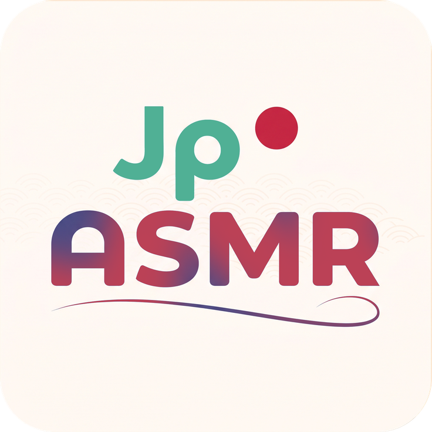
  <h1>JapaneseASMR Downloader</h1>
  <p><b>A high-performance native Android application for browsing, streaming, downloading, and playing Japanese ASMR audio works.</b></p>

  <p>
    <a href="README.md">English</a> |
    <a href="README.id.md">Bahasa Indonesia</a> |
    <a href="README.zh.md">简体中文</a>
  </p>

  <p>
    <a href="https://github.com/SayMaven/japaneseasmr-android/releases/latest"></a>
    <a href="https://github.com/SayMaven/japaneseasmr-android/blob/main/LICENSE"></a>
    
    
    
  </p>

  <p>
    <a href="#features">Features</a> •
    <a href="#screenshots">Screenshots</a> •
    <a href="#architecture--tech-stack">Architecture</a> •
    <a href="#download">Download</a> •
    <a href="#building-from-source">Building</a> •
    <a href="#license">License</a>
  </p>
</div>

---

> [!NOTE]
> This application was originally created for personal use, so there might still be some bugs. Thank you so much to everyone who has downloaded it! I will fix and improve things gradually in my spare time. Feel free to open an issue or PR!

## Overview

JapaneseASMR Downloader is a full-featured, open-source Android application engineered specifically for browsing, streaming, downloading, archiving, and listening to Japanese ASMR voice dramas (RJ / VJ / BJ works). Built with Jetpack Compose, Koin DI, Kotlin Coroutines, Room Database, AndroidX Media3 (ExoPlayer), and a native C++ Oboe / USB DAC audio engine, the app delivers desktop-grade streaming and bit-perfect local playback on mobile devices.

---

## Screenshots

<div align="center">
  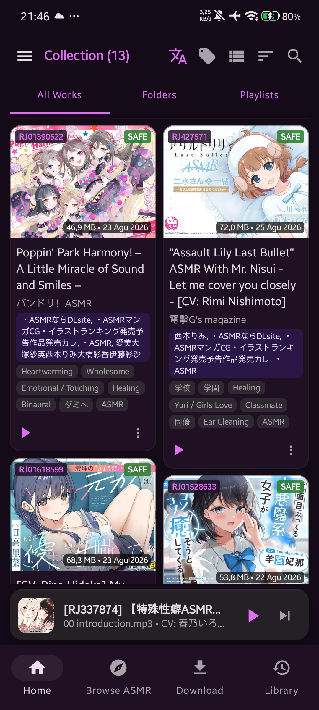
  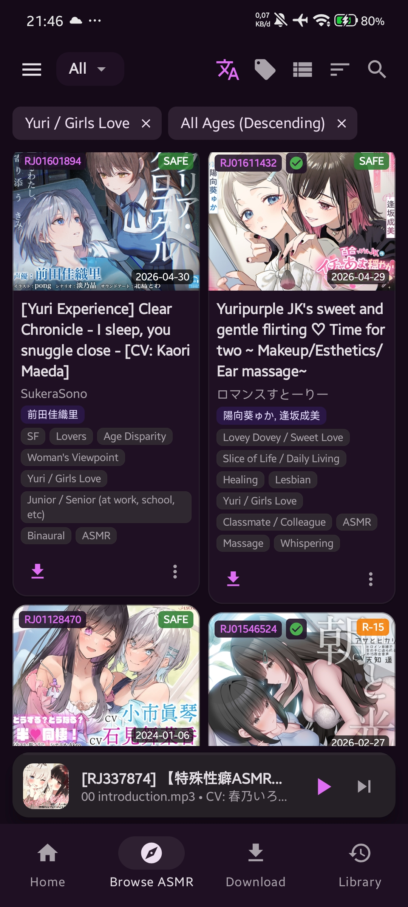
  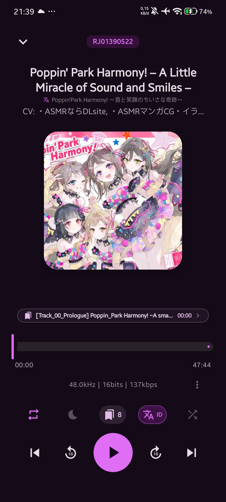
  <br />
  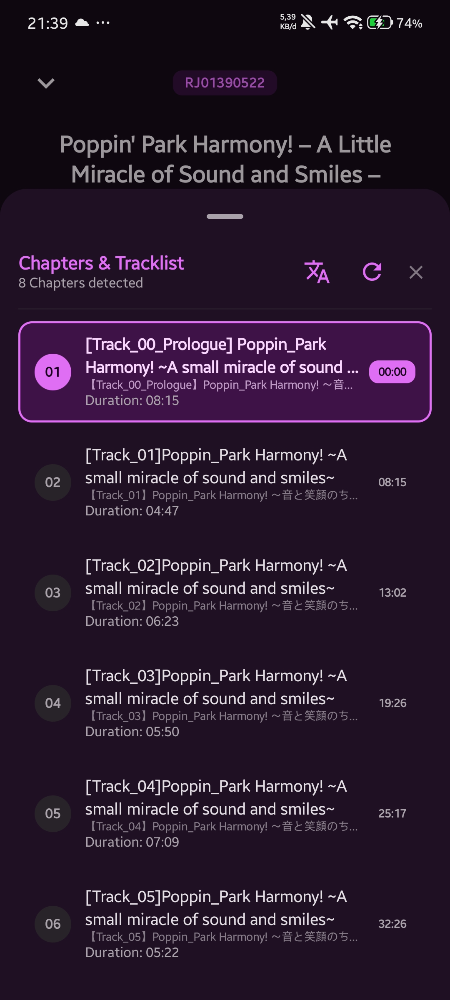
  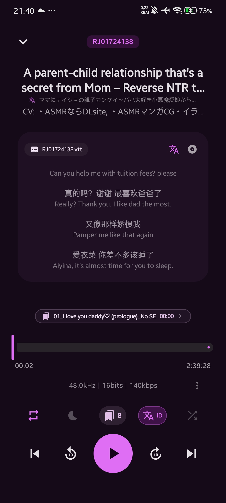
  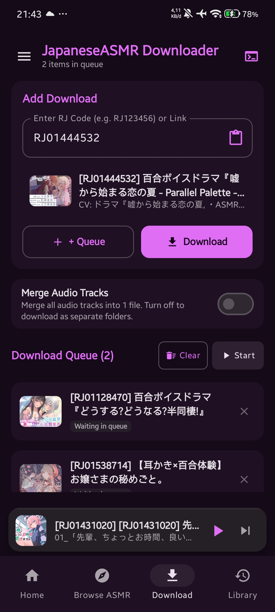
  <br />
  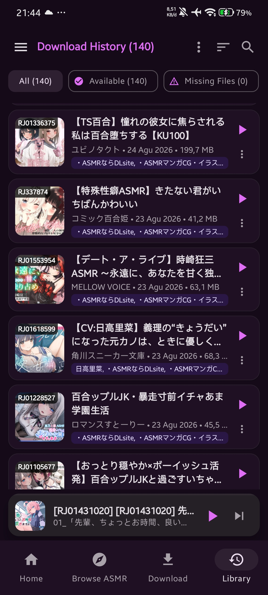
  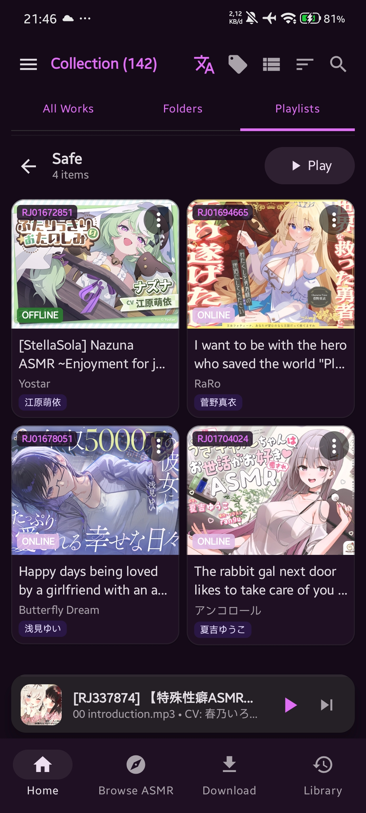
  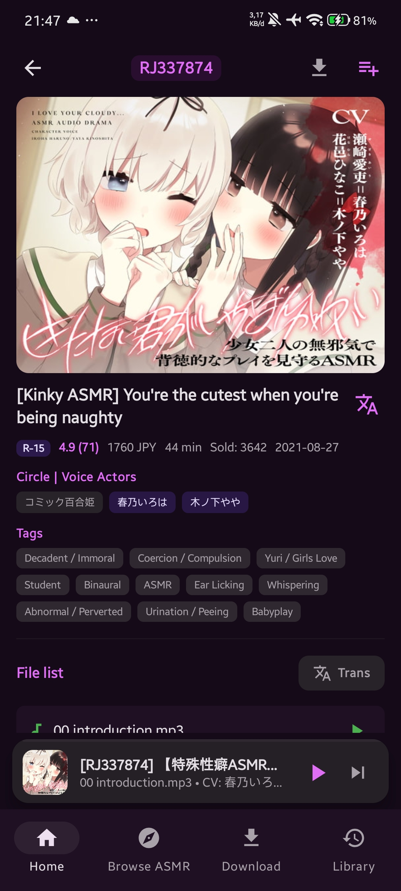
  <br />
  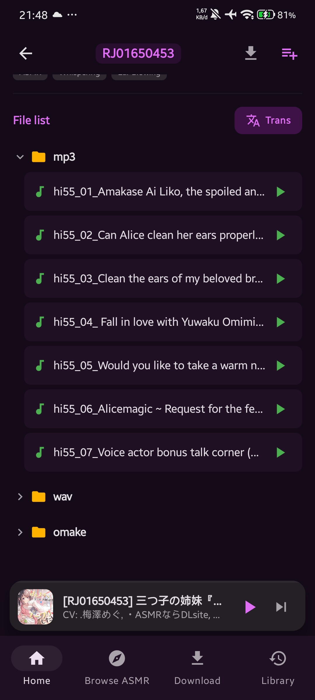
  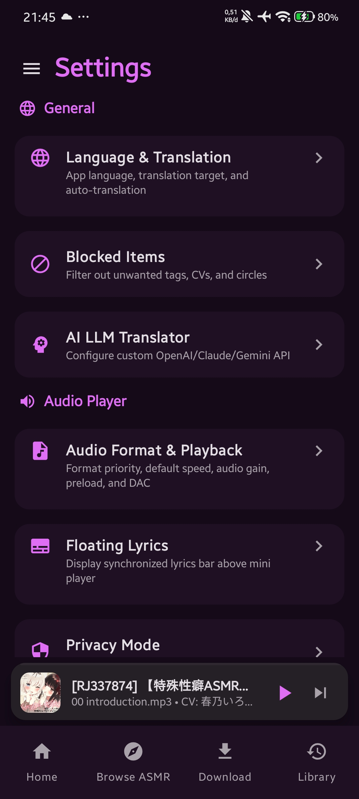
  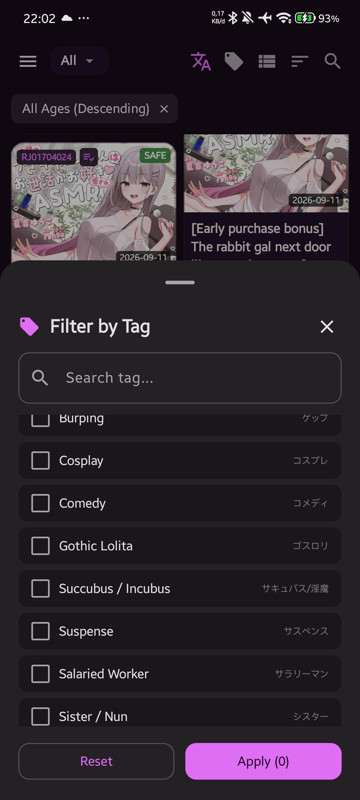
</div>

---

## Features

### ASMR Browse & Direct Online Streaming
* **Pinterest-Style Browse & Work Detail:** Browse ASMR works in grid or list view with KikoFlu-aligned sorting, multi-tag filtering, All-Ages safe mode, and an interactive Work Detail file tree.
* **Direct Online Audio Streaming:** Stream works directly online without downloading first, with automatic fallback from Playlist items when local files are removed.
* **Smart Track & Chapter Selection:** Automatically prioritizes main work folders (`本編` / `main`) over promo or recap subfolders (`販促`, `回想`) for accurate chapter lists and durations.

### Synchronized Subtitles, Floating Lyrics & Multi-Provider Translation
* **Built-in Subtitle Engine:** Supports `.vtt`, `.lrc`, and `.srt` subtitles with automatic ASMR backfill, an interactive synchronized lyrics panel, and an **in-app Floating Lyrics Bar** (enabled by default in translation mode).
* **Multi-Provider Translation & LLM Support:** Supports Google Translate (with sequential pacing plus `clients5` & `MyMemory` batch failover for `HTTP 429` resilience), Microsoft Edge, Youdao, MyMemory, and custom **LLM providers** (Claude, Gemini, OpenAI-compatible) with specialized Japanese & Chinese ASMR glossaries.
* **Encrypted API Keys & Dual-Tier Cache:** LLM API keys are encrypted via Android Keystore AES-256-GCM (`SecurePreferences`). Translations are cached in-memory (`ConcurrentHashMap`) and Room SQLite (`translation_cache`).

### Custom Playlists, Explorer Folders & Local Collection
* **Custom User Playlists (Room v6):** Organize both offline and online works in custom playlists with seamless **mixed online/offline queue navigation** (`Next`/`Previous`, `Shuffle`, `Repeat`, and auto-advance).
* **Local Folder & SD Card Import:** Import local folders or MicroSD/external storage via POSIX (`MANAGE_EXTERNAL_STORAGE`) or SAF (`DocumentFile`) as virtual multi-track albums, with Explorer-style folder thumbnails, RJ/VJ/BJ code linking, and custom cover art.
* **Card & Player Customization:** Choose which badges appear on Work Cards (Rating, Price, Sales, Release Date, Circle, `CC` Subtitle icon, Age Rating), search in the Local Collection header, and reorder Player action bar buttons.

### Integrated Native Audio Player, Gain Boost & Privacy Mode
* **Android MediaSession & Sleep Timer:** Foreground playback service with lock-screen artwork, notification controls, Floating Mini Player, and a pause-aware Sleep Timer.
* **Audio Gain Boost (dB) & USB DAC Exclusive Mode:** Amplify quiet ASMR whispers in dB through both ExoPlayer and the native C++ Oboe / UAC1–UAC2 USB DAC engine with hardware volume control.
* **Privacy Mode:** Blur cover art in-app and in system notifications, and mask work titles with customizable placeholder text.

### High-Speed Downloader, Cache Management & Backup
* **Merge or Multi-Track Folder Mode:** Choose whether to merge multi-track downloads into a single file (`FileChannel.transferTo` MP3 / M4A remux) or preserve the original folder structure, with automatic ID3v2/MP4 metadata tagging, CUE sheet export, and 4–32 parallel connections.
* **Cache Management & Auto-Clean:** Manage cache usage with a `200 MB – 10 GB` limit (`1 GB` default), optional Auto-Clean toggle (OFF by default to preserve history), and quick translation cache clearing.
* **JSON Backup & Restore + Refresh All Metadata:** Export/import Custom Playlists and Download History as JSON (plus automatic local backup), and bulk-refresh metadata for all local RJ/VJ/BJ works from Download Settings.

### OKLCH Color System & Adaptive Material 3 UI
* **OKLCH Perceptual Palette Engine:** 12 curated Light/Dark palettes alongside Material You Dynamic Color, with WCAG AA contrast, adaptive `NavigationRail` for tablets/landscape, and 4 UI languages (English, Indonesian, Japanese, Simplified Chinese).
* **In-App Auto-Updater:** Dual-channel (`*-debug.apk` / `*-release.apk`) GitHub Releases updater with `FileProvider` installation.

---

## Architecture & Tech Stack

| Layer | Component | Description |
| :--- | :--- | :--- |
| **UI Layer** | Jetpack Compose + Material 3 | Declarative UI, OKLCH perceptual theming, adaptive `NavigationRail` |
| **DI & Navigation** | Koin DI + Navigation Compose | Modular ViewModels/delegates, `@Serializable` type-safe `AppRoute` |
| **State Management** | Kotlin Coroutines + StateFlow | Reactive, lifecycle-aware unidirectional data flow |
| **Media & Native Audio** | AndroidX Media3 + C++ Oboe | ExoPlayer streaming/playback, MediaSession, USB DAC exclusive engine |
| **Local Database** | Room Database v6 (SQLite) | History, Custom Playlists, persistent `translation_cache` |
| **Audio Processing** | FastRemuxEngine + Jaudiotagger | Zero-copy MP3 merge, M4A remuxing, CUE export, ID3v2/MP4 tagging |
| **Translation Engine** | TranslationService + LLM Client | Google (`gtx` + `clients5`), MyMemory, Edge, Youdao, encrypted LLM APIs |
| **Networking & Images** | OkHttp 4 + Coil Compose | HTTP/2 pooling, multi-thread downloads, async cover caching |
| **Quality & Security** | Detekt + MockWebServer + Keystore | Static analysis, unit/migration tests, AES-256-GCM key storage, R8 shrinking |

---

## Download

Pre-compiled universal release APKs signed with the official SayMaven certificate are available on the GitHub Releases page:

[**Download Latest Release (GitHub Releases)**](https://github.com/SayMaven/japaneseasmr-android/releases/latest)

---

## Building from Source

### Prerequisites
* JDK 21
* Android SDK (compileSdk 36 / Build Tools 35+)
* Gradle 8.10.2 (included via Gradle Wrapper)

### Clone and Compile
```bash
# Clone the repository
git clone https://github.com/SayMaven/japaneseasmr-android.git
cd japaneseasmr-android

# Compile Debug APK
./gradlew assembleDebug
```

The compiled APK will be located at:
```text
app/build/outputs/apk/debug/JapaneseASMR-v2.0.0-debug.apk
```

---

## Disclaimer

This software is developed strictly for personal, educational, and backup archiving purposes. The developer does not host, distribute, or promote copyrighted media. Users are solely responsible for ensuring compliance with applicable copyright laws and service terms in their jurisdiction.

---

## License

This project is licensed under the [GNU General Public License v3.0 (GPL-3.0)](LICENSE).
