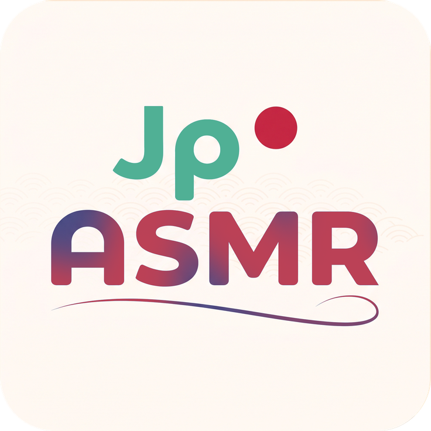
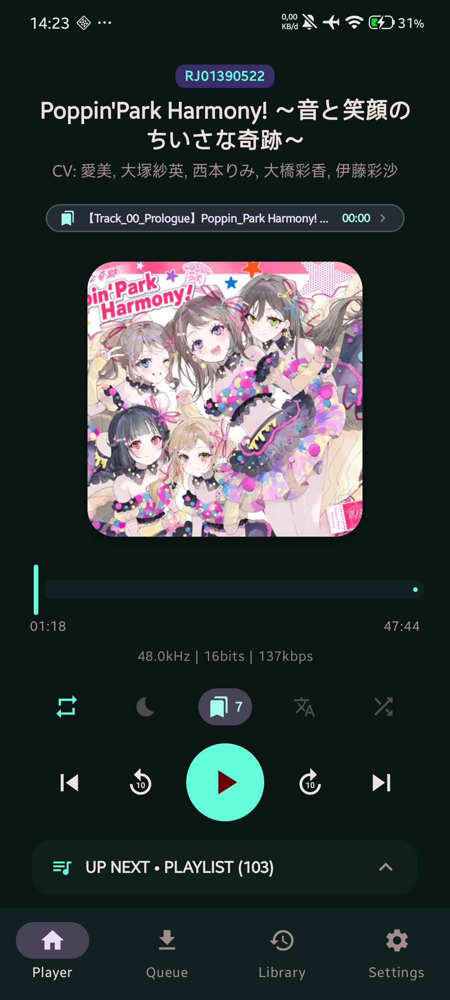
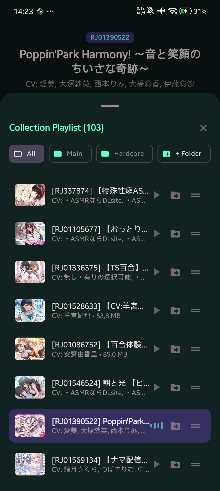
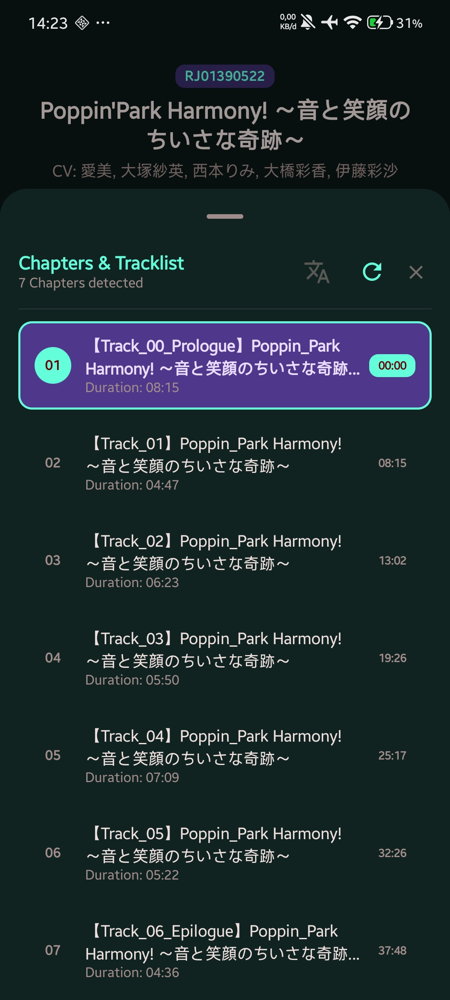
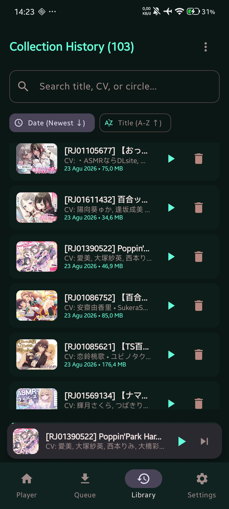
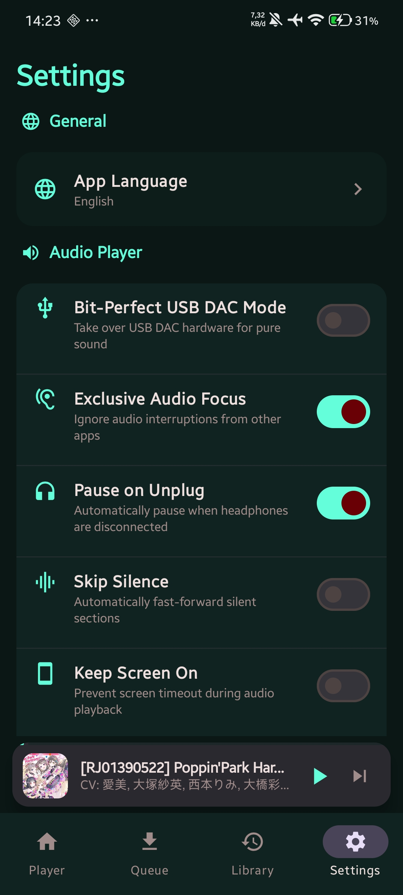
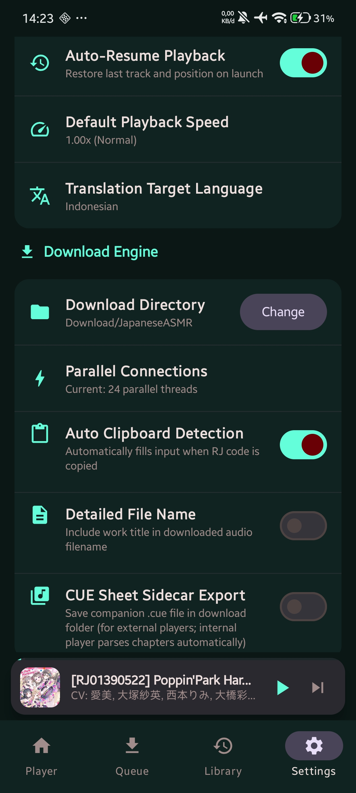

<div align="center">
  
  <h1>JapaneseASMR Downloader</h1>
  <p><b>A high-performance native Android application for downloading, managing, and playing Japanese ASMR audio works.</b></p>

  <p>
    <a href="README.md">English</a> |
    <a href="README.id.md">Bahasa Indonesia</a>
  </p>

  <p>
    <a href="https://github.com/SayMaven/japaneseasmr-android/releases/latest"></a>
    <a href="https://github.com/SayMaven/japaneseasmr-android/blob/main/LICENSE"></a>
    
    
    
  </p>

  <p>
    <a href="#whats-new-in-v130">What's New</a> •
    <a href="#features">Features</a> •
    <a href="#screenshots">Screenshots</a> •
    <a href="#download">Download</a> •
    <a href="#building-from-source">Building</a> •
    <a href="#architecture">Architecture</a> •
    <a href="#license">License</a>
  </p>
</div>

---

## Overview

JapaneseASMR Downloader is a full-featured, open-source Android application engineered specifically for downloading, archiving, and listening to Japanese ASMR voice dramas (RJ Works). Built from the ground up with Jetpack Compose, Kotlin Coroutines, Room Database, and AndroidX Media3 (ExoPlayer), the app delivers desktop-grade streaming performance, zero-OOM memory safety, and seamless background audio playback on mobile devices.

---

## What's New in v1.3.0

* **Context-Aware ASMR Translation & Naturalization Engine**:
  * Dual-tier translation architecture prioritizing Google Web Translate with automatic failover to the MyMemory Translation API.
  * Specialized DLsite fuseji censorship de-obfuscation (`〇`, `○`, `×`, `*`) prior to translation.
  * Specialized ASMR domain glossary and contextual naturalization empirically tested across 55 real DLsite works and 11 testing stages (~150 tropes) covering intimate scenarios, roleplay tropes, sound effects (onomatopoeia), and voice drama dialogue.
  * Live bilingual Japanese subtitle display under track titles in both the Player and Queue screens.
* **Persistent SQLite Room Caching (Database Schema v4)**:
  * Dual-tier caching pipeline: thread-safe in-memory cache (`ConcurrentHashMap`, 0ms) backed by persistent Room SQLite storage (`translation_cache` table, <2ms lookup).
  * High-efficiency bulk SQL `IN` query batch fetching (`getTranslationsBatch`) eliminating SQLite query thrashing and duplicate network requests across app launches.
  * Automated database schema migration (`MIGRATION_3_4`).
* **Smart Hybrid Chapter Mapping**:
  * Multi-tier narrative track classification and chronological ordering: Prologue, Main Story, Epilogue, Bonus/After, and Free Talk/Cast Comments.
  * Full Unicode NFKC normalization for accurate chapter numbering and multi-part track sequencing.
* **Fast Lossless Audio Remux Engine**:
  * Zero-copy kernel audio merger (`FileChannel.transferTo`) for MP3 streams and sequential container remuxing for AAC/M4A.
  * Instantaneous file merging (<1 second) without CPU-heavy transcoding, maintaining 100% original bitstream audio quality and seekability.
* **Unified Chapter Discovery & CUE Sheet Generation**:
  * Automated chapter extraction pipeline resolving embedded ID3v2 `CHAP`/`CTOC` frames, local `.cue` sidecars, and remote DLsite track listings.
  * Optional CUE sheet sidecar export switchable in Settings for third-party audiophile media players.
* **Universal Link & Code Resolver**:
  * Direct extraction and automatic resolution of RJ, VJ, and BJ product IDs from raw URLs (DLsite, asmr.one, and JapaneseASMR redirects).
* **120 FPS High Refresh Rate Scrolling Optimization**:
  * Elimination of disk I/O and IPC calls during playlist drag-and-drop reordering.
  * Pre-compiled regex patterns, optimized Coil memory caching, and fling-safe nested scroll interaction.
* **Refined Player & Queue User Interface**:
  * Redesigned player toolbar with translation toggle button, active language indicator, and compact chapter pill chip.
  * Adaptive cover artwork scaling with height boundary constraints (`max = 260.dp`) for optimal presentation across diverse screen ratios.
  * Bilingual download queue preview cards with real-time transfer telemetry and redesigned idle queue state.

---

## Screenshots

<div align="center">
  
  
  
  <br />
  
  
  
</div>

---

## Features

### Context-Aware ASMR Translation & Room Caching Engine
* **Specialized Domain Translation**: Translates Japanese titles, tracks, and chapters into fluent target language with DLsite-specific vocabulary adaptation.
* **Fuseji De-Obfuscation**: Automatically restores obscured characters in titles before translation to preserve contextual meaning.
* **Dual-Tier Translation Architecture**: Primary Google Web Translate engine with seamless fallback to MyMemory Translation API.
* **Dual-Tier Persistent Cache**: In-memory `ConcurrentHashMap` (0ms) backed by Room Database v4 SQLite table (`translation_cache`, <2ms), persisting translations across app restarts.
* **Bulk SQL Batch Fetching**: Single-query bulk retrieval (`getTranslationsBatch`) for playlists and tracklists, minimizing database and CPU overhead.
* **Bilingual Display**: Real-time bilingual display in the native audio player and download queue cards.

### Fast Lossless Audio Remux & Chapter Discovery Engine
* **Zero-Copy Kernel Audio Merger**: Merges multi-part MP3 files in under 1 second using `FileChannel.transferTo` without audio re-encoding or generational loss.
* **Sequential M4A Remuxing**: Assembles segmented AAC streams into standard ISO M4A containers for universal seeking support.
* **Smart Hybrid Chapter Mapping**: Automatically classifies and chronologically orders tracks into Prologue, Main Story, Epilogue, Bonus, and Free Talk tiers.
* **Unicode NFKC Normalization**: Eliminates numbering inconsistencies across circled, full-width, and kanji numerals.
* **Unified Chapter Discovery**: Intelligently resolves chapter markers from embedded ID3v2 `CHAP`/`CTOC` tags, companion `.cue` sheets, and DLsite metadata.
* **CUE Sheet Sidecar Export**: Generates external `.cue` files alongside audio for full compatibility with audiophile hardware and desktop players.
* **Universal Link & Code Resolver**: Accepts direct URLs from DLsite, asmr.one, and JapaneseASMR, automatically extracting product identifiers.

### High-Speed Download & Stream Demuxing Engine
* **Concurrent Parallel Connections (Multithread)**: Multi-threaded segment downloader supporting 4 to 32 parallel connections (default 16) for line-speed performance.
* **Dynamic Continuous Download Queue**: Adding new audio items while downloads are running automatically continues the queue until 100% complete without requiring manual restarts.
* **Zero-RAM Disk-Streaming Pipeline**: Stream demuxing directly to flash storage, enabling safe handling of multi-gigabyte audio tracks without risking `OutOfMemoryError`.
* **Standard Audio Remuxing**: Native ISO M4A / AAC container packaging ensuring complete seekability (0-second timeline scrubbing) across third-party audio players.
* **Automatic Storage Deduplication**: Detects existing files in your download folder and automatically skips redundant network requests.
* **Persistent Live Console**: Real-time progress monitoring, transfer speed calculation, and estimated completion time (ETA) with a persistent toggle button (`>_` / `</>`).

### Integrated Native Audio Player
* **Android MediaSession Integration**: Foreground audio playback service with rich notification controls and lock screen artwork display.
* **Smart Sleep Timer**: Built-in countdown timer with presets (5, 10, 15, 30, 60, 120 min) and +/- 5 min stepper buttons. Countdown automatically pauses when audio playback is paused.
* **Floating Mini Player (Tab-Aware)**: Interactive floating mini player bar displayed above the bottom navigation bar across Unduhan, Riwayat, and Pengaturan tabs for instant play/pause/skip and one-tap expansion.
* **True USB DAC Bit-Perfect Exclusive Takeover**: Direct USB Audio Class (UAC1 / UAC2) interface claiming with full Android kernel driver detach, isolating audio exclusively to the connected DAC with top priority.
* **DAC Hardware Volume Control & Solid Floating HUD**: Direct control of USB DAC hardware mixer via USB Control Transfers (`SET_CUR` / `GET_RANGE`), hardware volume key interception, and an ultra-slim 100% solid floating volume bar.
* **Interactive Chapter Drawer**: Tap-to-seek chapter drawer synchronized with player timeline and track progress.
* **0ms Instant Playlist Drawer**: Pre-cached reactive list with drag-and-drop reordering and instantaneous bottom sheet opening.
* **Modern Playback Speed Dialog**: Continuous smooth slider (0.25x - 2.0x) with zero tick dots and a balanced 2x3 quick preset grid.
* **Replay 10s & Forward 10s Controls**: Quick jump controls for navigating audio dialogue and chapters effortlessly.
* **Persistent Timeline Mode**: Toggling between total elapsed duration and remaining time (`-mm:ss`) persists across app restarts.
* **Strict Physical File Validation**: Automatically hides missing files in the playlist collection and refreshes in real-time when audio files are restored to storage.

### Library & Metadata Management
* **120 FPS High-Performance History Library**: Zero main-thread disk I/O blocking with precomputed UI models and stable keys for buttery-smooth 120 FPS list scrolling.
* **Realtime Storage Synchronization (StorageSyncManager)**: Automatically scans physical storage on launch/resume, synchronizing new, moved, or deleted audio files with the local Room database.
* **Smart Sorting Filters**: Instant ordering by Date (Newest / Oldest) with real millisecond timestamp precision and Title (A-Z / Z-A) with rock-solid list anchoring.
* **Uniform Date Formatting**: Clean, standardized date strings (`dd MMM yyyy`) across the entire app.
* **Complete Metadata Tagging**: Embeds high-resolution cover artwork, Voice Actor (CV), Circle/Author, Work Title, and Genre tags directly into audio files (ID3v2 / MP4 atom).
* **Search & Collection Filtering**: Search your offline library by RJ Code, title, voice actor, or circle.

### Modern Material Design 3 UI & Navigation
* **4 Independent Navigation Tabs**: Home (Full Audio Player), Unduhan (Download Queue), Riwayat (Audio Library), and Pengaturan (Settings).
* **Deterministic Tab Retention**: Cold starts always begin at Home, while minimizing and reopening the app preserves the exact active tab without unwanted jumps.
* **Dynamic Material You / Monet Engine**: Automatic color palette generation based on Android 12+ wallpaper colors.
* **36 Curated Color Palettes**: Comprehensive theme selection with 3-segment circle previews, smooth horizontal carousel, and 9-dot pagination.
* **0ms Instant Startup Fast Cache**: Synchronous caching of theme preferences eliminates cold start dynamic color flicker.
* **Instant 0ms Tab Switching**: Retained GPU RenderNode layer architecture for zero-delay switching across tabs.
* **System, Dark, and Light Modes**: Full day/night theme support with smooth transitions.

---

## Architecture & Tech Stack

JapaneseASMR Downloader adheres strictly to Modern Android Architecture guidelines with separation of concerns and reactive data flow:

| Layer | Component | Description |
| :--- | :--- | :--- |
| **UI Layer** | Jetpack Compose + Material 3 | Declarative UI, Animations, Dynamic Monet Theming |
| **State Management** | Kotlin Coroutines + StateFlow | Reactive, lifecycle-aware unidirectional data flow |
| **Media Player** | AndroidX Media3 (ExoPlayer) | Native audio decoding, MediaSession, Foreground Service |
| **Local Database** | Room Database v4 (SQLite) | Library history, persistent translation cache (`translation_cache`), internal chapter mapping |
| **Audio Processing** | FastRemuxEngine | Zero-copy kernel MP3 merge, sequential M4A remuxing, CUE sheet sidecar export |
| **Translation Engine** | TranslationService | Dual-tier Google Web/MyMemory APIs, ASMR domain naturalization, fuseji de-obfuscation |
| **Preferences** | AndroidX DataStore + SharedPreferences Fast Cache | Type-safe persistence with 0ms synchronous startup cache |
| **Networking** | OkHttp 4 | HTTP/2 connection pooling, multi-thread segment downloads |
| **Audio Tagging** | Jaudiotagger | ID3v2 (`CHAP`/`CTOC`), MP4 atom, and metadata embedding |
| **Image Loading** | Coil Compose | Asynchronous image decoding, memory and hardware bitmap caching |

---

## Download

Pre-compiled universal release APKs signed with the official SayMaven certificate are available on the GitHub Releases page:

[**Download Latest Release (GitHub Releases)**](https://github.com/SayMaven/japaneseasmr-android/releases/latest)

---

## Building from Source

### Prerequisites
* JDK 17 or higher
* Android SDK with Build Tools 35.0.0+
* Gradle 8.7+ (included via Gradle Wrapper)

### Clone and Compile
```bash
# Clone the repository
git clone https://github.com/SayMaven/japaneseasmr-android.git
cd japaneseasmr-android

# Compile Debug APK
./gradlew assembleDebug
```

The compiled APK will be located at:
```
app/build/outputs/apk/debug/JapaneseASMR-v1.3.0-debug.apk
```

---

## Disclaimer

This software is developed strictly for personal, educational, and backup archiving purposes. The developer does not host, distribute, or promote copyrighted media. Users are solely responsible for ensuring compliance with applicable copyright laws and service terms in their jurisdiction.

---

## License

This project is licensed under the [GNU General Public License v3.0 (GPL-3.0)](LICENSE).
