<div align="center">
  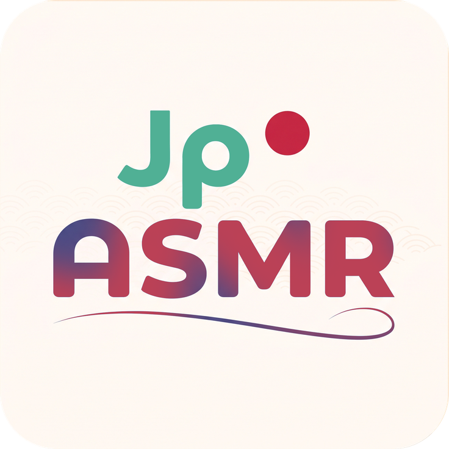
  <h1>JapaneseASMR Downloader</h1>
  <p><b>一款用于浏览、在线串流、下载、管理和播放日本 ASMR 声音作品的高性能原生 Android 应用程序。</b></p>

  <p>
    <a href="README.md">English</a> |
    <a href="README.id.md">Bahasa Indonesia</a> |
    <a href="README.zh.md">简体中文</a>
  </p>

  <p>
    <a href="https://github.com/SayMaven/japaneseasmr-android/releases/latest"></a>
    <a href="https://github.com/SayMaven/japaneseasmr-android/blob/main/LICENSE"></a>
    
    
    
  </p>

  <p>
    <a href="#功能特性">功能特性</a> •
    <a href="#应用截图">应用截图</a> •
    <a href="#架构设计与技术栈">架构设计</a> •
    <a href="#下载安装">下载安装</a> •
    <a href="#源码构建">源码构建</a> •
    <a href="#开源协议">开源协议</a>
  </p>
</div>

---

> [!NOTE]
> 该应用最初仅用于个人用途，目前可能仍存在一些 Bug。非常感谢大家的下载支持！我会在有空余时间时逐步修复和完善。欢迎随时提出 Issue 或提交 PR！

## 概述

**JapaneseASMR Downloader** 是一款专为浏览、在线串流、下载、归档和聆听日本 ASMR 同人音声广播剧（RJ / VJ / BJ 作品）而设计的全功能开源 Android 客户端。应用基于 Jetpack Compose、Koin DI、Kotlin 协程、Room 数据库、AndroidX Media3 (ExoPlayer) 以及原生 C++ Oboe / USB DAC 音频引擎构建，在移动设备上带来流畅的在线播放与源码率本地听音体验。

---

## 应用截图

<div align="center">
  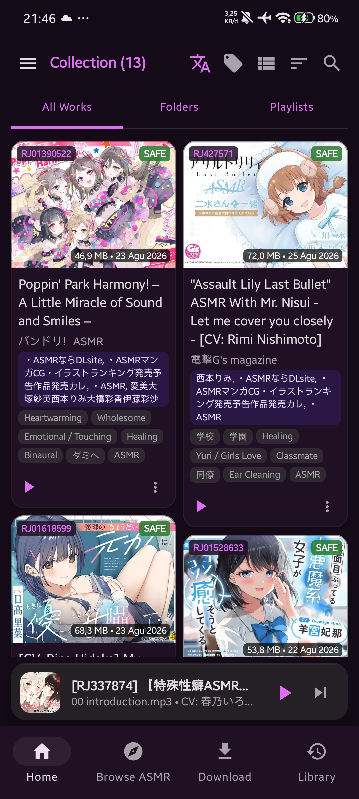
  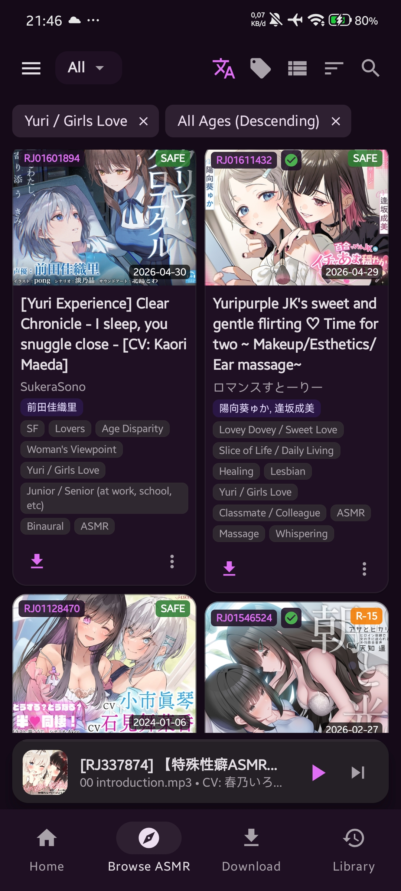
  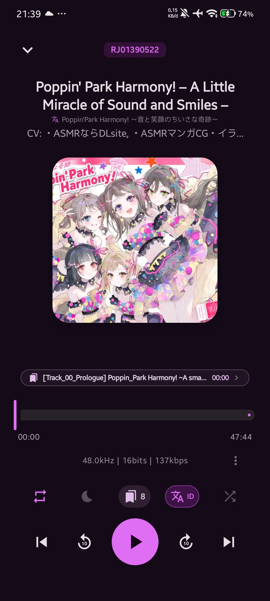
  <br />
  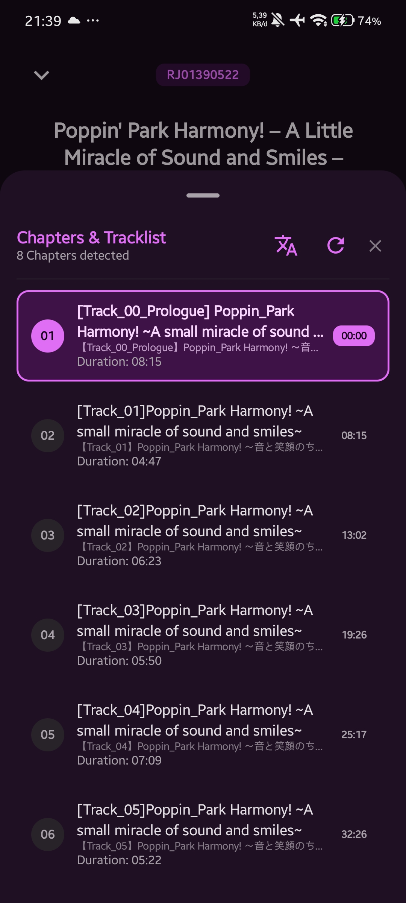
  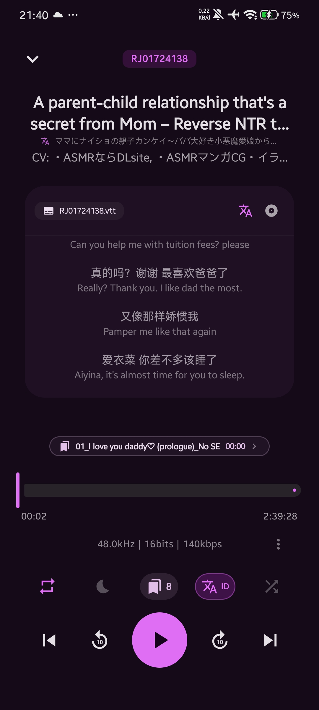
  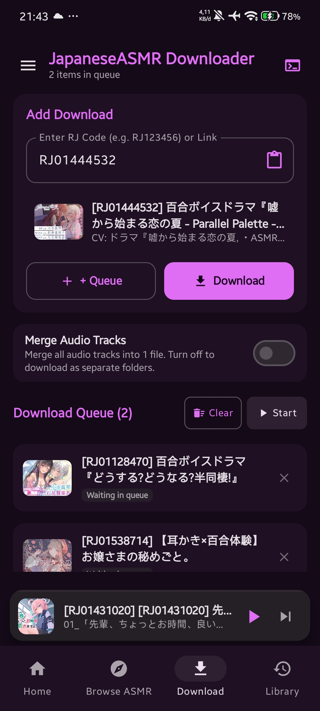
  <br />
  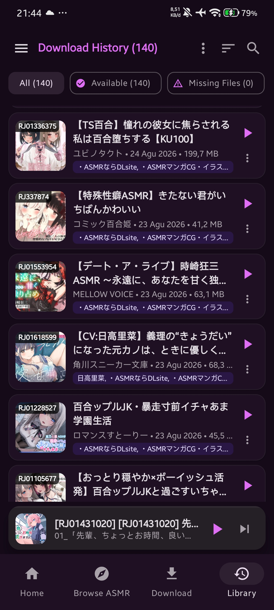
  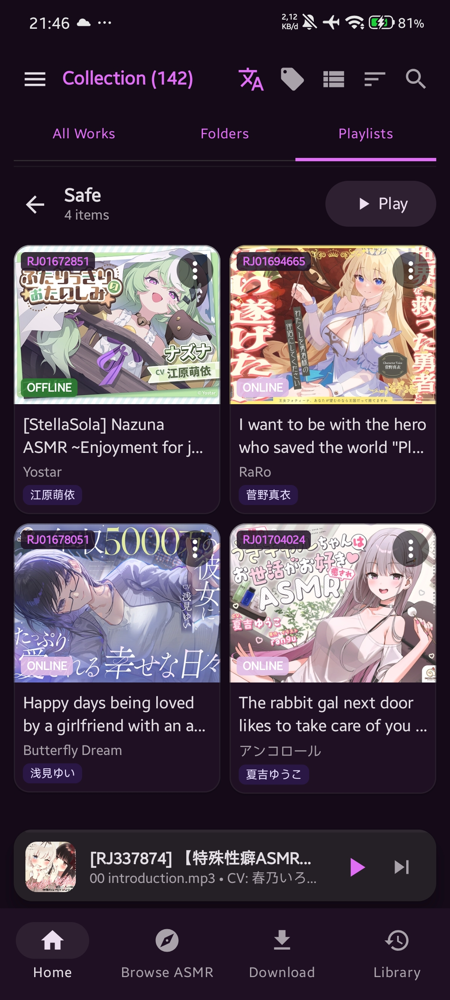
  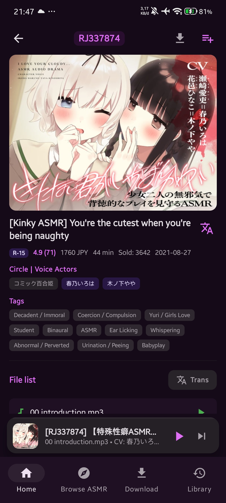
  <br />
  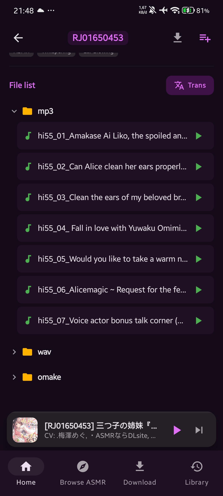
  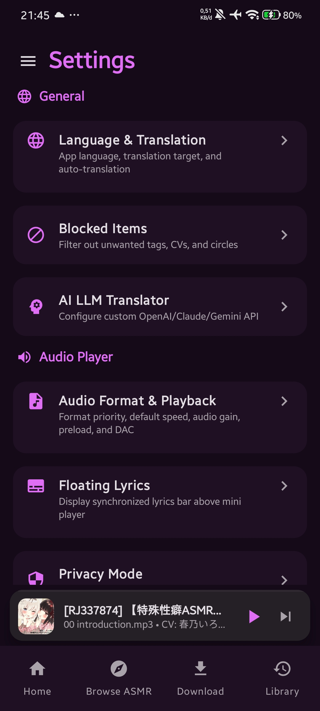
  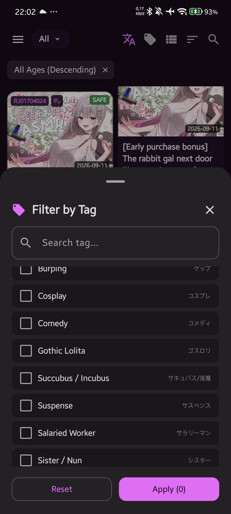
</div>

---

## 功能特性

### ASMR 浏览与在线直接串流
* **Pinterest 风格浏览与作品详情**：支持网格/列表视图、KikoFlu 同步排序、多标签筛选、全年龄安全模式以及交互式文件树。
* **在线直接串流播放**：无需预先下载即可直接在线收听；若播放列表中的本地文件已被删除，将自动无缝回退至在线串流。
* **智能主线音轨与章节识别**：自动优先识别作品本篇目录（`本編` / `main`），排除贩促与回想特典目录（`販促`、`回想`），确保章节数与总时长准确无误。

### 同步字幕、悬浮歌词与多引擎翻译
* **内置字幕引擎**：支持 `.vtt`、`.lrc`、`.srt` 字幕及自动回填，提供播放器同步歌词面板与应用内**悬浮歌词栏**（默认开启翻译模式）。
* **多引擎翻译与自定义 LLM**：支持 Google 翻译（顺序限流搭配 `clients5` 与 `MyMemory` 批量容灾，缓解 `HTTP 429`）、Microsoft Edge、有道、MyMemory 及自定义 **LLM 模型**（Claude、Gemini、OpenAI 兼容接口），内置日语/中文 ASMR 专业术语表。
* **密钥加密与双层缓存**：通过 Android Keystore AES-256-GCM（`SecurePreferences`）加密保存 LLM API 密钥，并由内存 `ConcurrentHashMap` 与 Room SQLite（`translation_cache`）持久化缓存翻译结果。

### 自定义播放列表、资源管理器目录与本地收藏
* **自定义播放列表（Room v6）**：同一播放列表可混合收藏离线与在线作品，支持列表内无缝**上一曲/下一曲、随机、循环与自动连播**。
* **本地目录与 SD 卡导入**：支持通过 POSIX（`MANAGE_EXTERNAL_STORAGE`）或 SAF（`DocumentFile`）将本地与 MicroSD 卡目录导入为虚拟多音轨专辑，支持资源管理器风格目录缩略图、RJ/VJ/BJ 关联及自定义封面。
* **卡片与播放器自定义**：自由开关作品卡片徽章（评分、价格、销量、发售日、社团、`CC` 字幕图标、年龄分级），支持本地收藏顶栏搜索及播放器按钮顺序自定义。

### 原生音频播放器、增益放大 (dB) 与隐私模式
* **MediaSession 与睡眠定时**：支持锁屏封面、媒体通知栏、全局悬浮 Mini Player，以及随音频暂停自动暂停的睡眠定时器。
* **音频增益放大 (dB) 与 USB DAC 独占输出**：可在 ExoPlayer 与原生 C++ Oboe / UAC1–UAC2 USB DAC 引擎上直接放大微弱耳语音量（dB），并支持 DAC 硬件音量控制。
* **隐私模式**：支持应用内及系统通知封面模糊，以及自定义占位标题遮罩。

### 高速下载、缓存管理与备份恢复
* **合并单文件 / 多目录下载模式**：可自由选择将多音轨无损合并为单文件（`FileChannel.transferTo` MP3 / M4A 重封装）或保留原始目录结构，支持自动写入 ID3v2/MP4 标签、导出 `.cue` 轨表及 4–32 并发线程。
* **缓存管理与自动清理**：支持配置 `200 MB – 10 GB` 缓存上限（默认 `1 GB`）、可选自动清理开关（默认关闭以保护历史记录）及一键清除翻译缓存。
* **JSON 备份恢复与批量刷新元数据**：支持导出/导入播放列表与下载历史 JSON 文件（含自动本地镜像备份），并在下载设置中提供一键**刷新全部元数据**。

### OKLCH 色彩系统与自适应 Material 3 界面
* **OKLCH 感知调色板引擎**：内置 12 套明暗主题调色板并支持 Material You 动态取色，符合 WCAG AA 对比度标准，支持平板/横屏 `NavigationRail` 自适应布局与 4 种界面语言（英语、印尼语、日语、简体中文）。
* **应用内双通道自动更新**：自动匹配调试版/正式版 APK（`*-debug.apk` / `*-release.apk`）并通过 `FileProvider` 安全安装。

---

## 架构设计与技术栈

| 架构层级 | 核心组件 | 职责与技术说明 |
| :--- | :--- | :--- |
| **UI 表现层** | Jetpack Compose + Material 3 | 声明式界面、OKLCH 感知主题、自适应 `NavigationRail` |
| **依赖注入与导航** | Koin DI + Navigation Compose | 模块化 ViewModel/Delegate、`@Serializable` 类型安全路由 `AppRoute` |
| **状态管理** | Kotlin Coroutines + StateFlow | 响应式、生命周期感知型单向数据流（UDF） |
| **媒体与原生音频** | AndroidX Media3 + C++ Oboe | ExoPlayer 串流/播放、MediaSession、USB DAC 硬件独占引擎 |
| **本地持久化** | Room Database v6 (SQLite) | 下载历史、自定义播放列表、`translation_cache` 持久缓存 |
| **音频处理** | FastRemuxEngine + Jaudiotagger | 零拷贝 MP3 拼接、M4A 重封装、CUE 导出、ID3v2/MP4 标签写入 |
| **翻译引擎** | TranslationService + LLM Client | Google（`gtx` + `clients5`）、MyMemory、Edge、有道、加密 LLM 接口 |
| **网络与图像** | OkHttp 4 + Coil Compose | HTTP/2 连接池、多线程下载、异步封面缓存 |
| **质量与安全** | Detekt + MockWebServer + Keystore | 静态代码检查、单元/迁移测试、AES-256-GCM 密钥存储、R8 体积优化 |

---

## 下载安装

您可以在 GitHub Releases 页面下载由官方密钥签名的最新通用正式版 APK 安装包：

[**前往下载最新正式版（GitHub Releases）**](https://github.com/SayMaven/japaneseasmr-android/releases/latest)

---

## 源码构建

### 环境要求
* JDK 21
* Android SDK（compileSdk 36 / Build Tools 35+）
* Gradle 8.10.2（项目已通过 Gradle Wrapper 包含）

### 克隆仓库与编译
```bash
# 克隆仓库
git clone https://github.com/SayMaven/japaneseasmr-android.git
cd japaneseasmr-android

# 编译 Debug APK
./gradlew assembleDebug
```

编译生成的 APK 文件将位于：
```text
app/build/outputs/apk/debug/JapaneseASMR-v2.0.0-debug.apk
```

---

## 免责声明

本软件仅供个人学习、研究及合法备份归档使用。开发者不提供任何受版权保护的音视频文件存储、分发或推广服务。用户在使用本应用时，需自行承担一切法律责任，并确保符合所在国家或地区的著作权法律法规。

---

## 开源协议

本项目采用 [GNU 通用公共许可证 v3.0 (GPL-3.0)](LICENSE) 开源。
